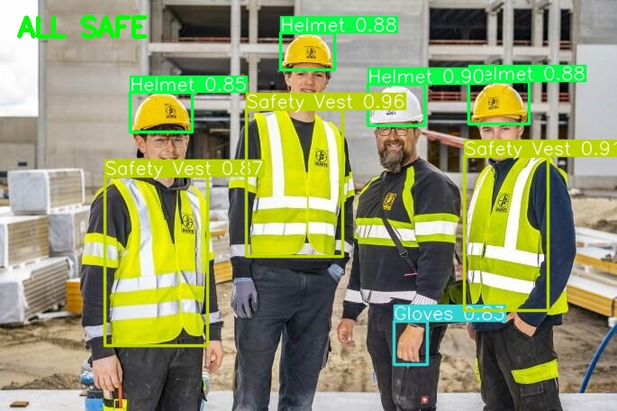

This project uses YOLOv8 to help us detect safety equipment in images and videos.

The main goal is to detect PPE items and identify possible safety violations,such as missing helmets or safety vests

I trained the model using Google Colab and built a simple web app with Streamlit.

## Demo

The app allows users to upload an image or a video, It then shows the detected objects with bounding boxes. If a helmet or safety vest violation is detected, the app displays a warning.

Videos are processed frame by frame and can be downloaded after being processed.

 

## Features

- PPE detection using YOLOv8

-Supports helmets, gloves, safety shoes,masks, safety vests, and other equipment

- also Checks for missing helmets and safety vests

- Supports images and videos

- Uses smoothing to reduce unstable video alerts

## Dataset

to train the model i used a PPE dataset from Roboflow(https://universe.roboflow.com/radwans-workspace/ppe-dataset-orfty-trogr)

## Model Training

for trainig i used YOLOv8n from Ultralytics and trained the model on google colab.

The project main steps:

1YOLO detects ppe objects in an image or a video frame

2The code checks the detected classes for helmet and safety vest violations

3the model adds Bounding boxes and warning messages to the image

4Streamlit displays the results

## Results

The model can detect different PPE items, including helmets and safety vests and also checks for missing helmets and safety vests.For videos, it processes each frame and counts frames where violations are detected.

The results are not always perfect. Sometimes the model makes incorrect predictions, especially when objects are small or difficult to see.

things I worked on during this project:

- Handling image colors in OpenCV(RGB and BGR)

- Fixing problems with video output and codecs

- Working with video frames

- Dealing with false detections

- Connecting the trained model to Streamlit

## Limitations

- The model sometimes makes false predictions.

- It does not check which PPE item belongs to which person

- The violation logic currently focuses on helmets and safety vests

- Detection can be less accurate in poor lighting or when objects are hidden

- Processing long videos can take time,especially on a CPU

what I would like to add later:

- Better matching between workers and their PPE

- Object tracking for videos

- More training data

- Faster video processing

- Better deployment options

